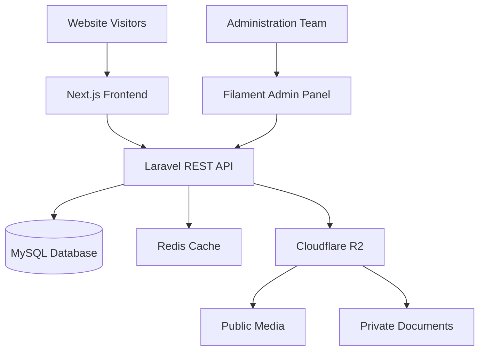

# TEDx Jabal Tareq — Technical Case Study

<p align="center">
  <strong>Engineering a Digital Platform for TEDx Jabal Tareq</strong>
</p>

<p align="center">
  <a href="https://tedxjabaltareq.org/">Live Website</a>
  · Technical Documentation
  · System Architecture
</p>

---

## Overview

**TEDx Jabal Tareq** is a digital platform developed to support the organization's online presence and event operations.

The platform brings together a modern frontend, a modular backend architecture, and cloud-based media storage to provide a structured experience for visitors and the team managing the platform.

This repository documents the technical architecture, engineering decisions, technologies, and development work behind the platform.

> **Important:** This is a technical documentation repository. The production source code is maintained separately in a private repository and is not included here.

## My Role

**Lead Developer**

I was responsible for designing, developing, and maintaining the platform across its frontend and backend components.

My work includes:

- Designing and implementing the backend architecture.
- Developing the frontend and integrating it with backend services.
- Building and maintaining RESTful APIs.
- Organizing backend modules and application responsibilities.
- Implementing authentication and role-based access control.
- Integrating cloud storage for public media and private documents.
- Working on application performance, caching, and maintainability.
- Supporting the platform's ongoing development and improvements.

## Technology Stack

| Layer | Technologies |
|---|---|
| Backend | PHP, Laravel 13 |
| Frontend | Next.js |
| Admin Panel | Filament 5 |
| API | RESTful APIs |
| Database | MySQL |
| Authentication | Laravel Sanctum |
| Authorization | Spatie Permission, Filament Shield |
| Media Management | Spatie Media Library |
| Caching | Redis |
| File Storage | Cloudflare R2 |
| Testing | Pest |

## System Architecture

The platform follows a frontend/backend separation, with Laravel providing the backend services and Next.js delivering the user-facing experience.



### Architecture Principles

- **Separation of Concerns:** Frontend, backend, and administrative responsibilities are separated.
- **Modular Backend:** Application functionality is organized into modules to improve maintainability and support future development.
- **API-Driven Integration:** The frontend communicates with backend services through versioned REST APIs.
- **Access Control:** Authentication and permissions help control access to administrative functionality and protected resources.
- **Cloud-Based Storage:** Media and documents are stored separately from the application database.

## Backend Architecture

The backend is built with Laravel and follows a modular architecture.

The goal is to keep application responsibilities organized, make features easier to maintain, and reduce unnecessary coupling between different parts of the system.

Key backend areas include:

- API development and request handling.
- Business logic and application services.
- Database operations and relationships.
- Authentication and authorization.
- Media and document management.
- Caching and performance considerations.

## Frontend Architecture

The frontend is developed using Next.js.

It provides the public-facing interface and communicates with the Laravel backend through RESTful APIs.

The frontend is responsible for presenting the organization's content and providing visitors with access to platform features.

## Authentication & Authorization

The platform uses Laravel Sanctum for authentication and Spatie Permission for role and permission management.

Filament Shield is used to support authorization within the administrative panel.

These components provide a structured approach to managing authenticated access and administrative permissions.

## Storage & Infrastructure

The platform uses **Cloudflare R2** for file storage.

Separate storage buckets are used for different access requirements:

| Storage | Purpose |
|---|---|
| Public Bucket | Public website media and assets |
| Private Bucket | Restricted documents and private files |

Public media is delivered through a dedicated CDN domain, while private documents are kept separate from publicly accessible assets.

## Performance & Maintainability

Several technical decisions support the platform's maintainability and performance:

- Redis-based caching.
- Modular backend organization.
- Separation between frontend and backend.
- Reusable application components.
- Dedicated cloud storage for media and documents.

## Key Engineering Considerations

Some of the main engineering considerations throughout the project include:

1. Maintaining a clear separation between the public website and backend services.
2. Organizing the backend so new functionality can be added without making the application difficult to maintain.
3. Managing public and private files with different access requirements.
4. Providing structured access control for administrative operations.
5. Keeping frontend/backend communication consistent through versioned APIs.

## Project Screenshots

Screenshots and selected visual references will be added here to demonstrate the platform's interface and functionality.

<!-- Add approved screenshots inside the screenshots/ directory. -->

## Repository Structure

This repository is intended to grow as the technical documentation develops.

```text
tedxjt-project/
├── README.md
├── docs/
│   ├── system-architecture.md
│   ├── backend-architecture.md
│   ├── frontend-architecture.md
│   ├── database-design.md
│   ├── api-documentation.md
│   ├── authentication-and-security.md
│   ├── storage-and-infrastructure.md
│   └── technical-decisions.md
├── diagrams/
└── screenshots/
```

## About the Project

**Project:** TEDx Jabal Tareq  
**Role:** Lead Developer  
**Website:** https://tedxjabaltareq.org/

This case study presents selected technical aspects of the platform for professional and educational purposes.

The production source code, credentials, private documents, and internal operational data are intentionally excluded from this repository.

---

<p align="center">
  <strong>Designed, developed, and maintained with a focus on clean architecture, maintainability, and practical engineering.</strong>
</p>
